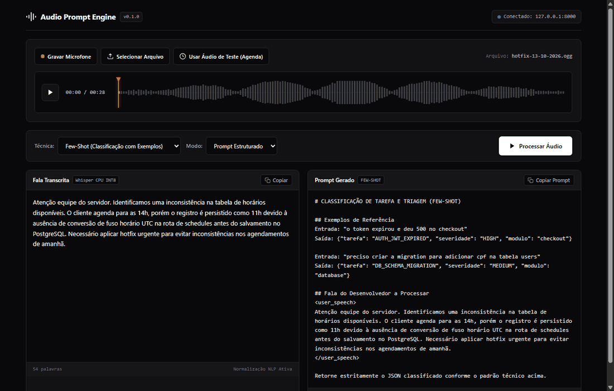

# Audio Prompt Engine

Compilador de prompts a partir de voz (*Speech-to-Structured-Prompt*) em Python (FastAPI). Transcreve áudio localmente via Whisper INT8 em CPU, remove disfluências da fala e compila o texto em prompts estruturados prontos para você copiar e colar no Claude, ChatGPT, Cursor ou PRs.

O fluxo de valor é direto:  
**Voz** -> **Whisper Medium INT8 (CPU)** -> **Normalização NLP** -> **Prompt Estruturado Pronto (com botão Copiar)**.

---

## Demonstração



Ao executar `uv run uvicorn src.main:app --port 8000`, a interface web completa fica disponível em `http://localhost:8000/`, permitindo gravar pelo microfone ou enviar arquivos de áudio, acompanhar a transcrição em tempo real, selecionar a técnica desejada e copiar o prompt estruturado gerado com um único clique.

---

## Inicialização Rápida

```bash
# 1. Clonar repositório
git clone https://github.com/ElyssonAlvs/audio-prompt-engine.git
cd audio-prompt-engine

# 2. Instalar dependências
uv sync

# 3. Iniciar servidor
uv run uvicorn src.main:app --port 8000
```

Para executar em container via Docker:

```bash
docker compose up --build
```

Endpoints locais:
- Interface Web: `http://localhost:8000/`
- Documentação Swagger: `http://localhost:8000/docs`
- Health Check: `http://localhost:8000/health`

---

## Fluxo de Processamento

1. **Entrada de Áudio:** Gravação direta via microfone do navegador ou envio de arquivo de áudio (WAV, MP3, OGG, WebM, FLAC, M4A) com limite de até 25 MB.
2. **Transcrição Local:** Inferência local via `faster-whisper` com o modelo `medium` (769M parâmetros em INT8 na CPU), garantindo alta fidelidade fonética para o português do Brasil sem envio de dados para APIs externas.
3. **Limpeza NLP:** Remoção algorítmica de hesitações (*"ééé"*, *"tipo assim"*, *"né"*) e desduplicação de repetições consecutivas (*"do do"* -> *"do"*).
4. **Compilação do Prompt:** Higienização contra injeções acústicas e formatação em prompt estruturado delimitado por tags `<user_speech>`, pronto para cópia e envio direto para Claude, ChatGPT, Cursor ou PRs.

---

## As 6 Técnicas de Prompt

| Técnica (`prompt_technique`) | Objetivo | Exemplo Prático |
|---|---|---|
| **`zero_shot`** | Instrução direta sem exemplos prévios. | Perguntas objetivas, refatorações pontuais e resumos. |
| **`few_shot`** | Pares de entrada e saída esperada para formatar o retorno. | Extração de entidades e padronização em JSON/YAML. |
| **`chain_of_thought`** | Decomposição do raciocínio passo a passo antes da resposta. | Depuração de bugs, cálculos e lógica de negócios. |
| **`role_prompting`** | Atribuição de perfil especialista ao modelo. | Code review sênior, parecer técnico e auditoria. |
| **`co_star`** | Estruturação em 6 pilares (Context, Objective, Style, Tone, Audience, Response). | Especificações técnicas, relatórios e documentos corporativos. |
| **`react`** | Ciclo iterativo de raciocínio e ação (*Thought*, *Action*, *Observation*). | Planejamento de tarefas multi-etapas e agentes autônomos. |

---

## Persistência em Banco SQLite

Os jobs, transcrições e prompts compilados são persistidos localmente no banco SQLite em `data/audio_prompt_engine.db`, garantindo histórico de execuções com isolamento multi-tenant estrito.

---

## Endpoints da API

Todas as rotas autenticadas exigem o header `X-API-Key`.

| Método | Rota | Descrição |
|---|---|---|
| `GET` | `/` | Interface web da aplicação com gravação e botão de cópia de prompt. |
| `POST` | `/api/v1/transcriptions` | Envia áudio para transcrição limpa (`output_mode="txt"`) ou compilação de prompt (`output_mode="prompt"`). |
| `GET` | `/api/v1/transcriptions/{job_id}` | Consulta metadados, texto transcrito e prompt sintetizado de um job. |
| `GET` | `/api/v1/transcriptions/{job_id}/txt` | Download da transcrição normalizada em texto puro (`text/plain`). |
| `GET` | `/api/v1/techniques` | Catálogo das 6 técnicas de engenharia de prompt suportadas. |
| `GET` | `/health` | Verificação de integridade e status do modelo Whisper. |

A collection pronta para o Insomnia está disponível em [`docs/audio-prompt-engine.insomnia.json`](docs/audio-prompt-engine.insomnia.json).

---

## Testes Automatizados

Suíte completa com 100 testes automatizados aprovados (100% verde), cobrindo testes unitários, fluxos de ponta a ponta (e2e) e segurança defensiva:

```bash
uv run pytest -v
```

---

## Decisões Arquiteturais

As decisões técnicas e seus históricos estão documentados em:
- [Consolidação de Decisões Arquiteturais (ADRs)](docs/ARCHITECTURAL_DECISIONS.md)
