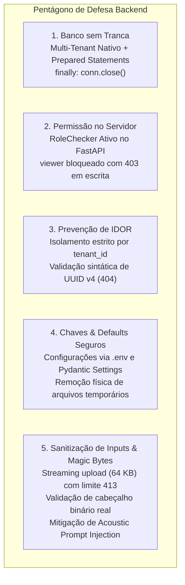

# 🎙️ Audio Prompt Engine

> **Motor inteligente de transcrição de áudio local e engenharia de prompts estruturados para LLMs.**  
> Transforma a fala humana em texto limpo e normalizado (`.txt`) ou em prompts otimizados de alta fidelidade para modelos de linguagem através de técnicas consagradas de engenharia cognitiva.

---

## 📌 Visão Geral

O **`audio-prompt-engine`** é uma solução backend de alta performance desenvolvida em Python 3.12 (FastAPI), projetada para eliminar o abismo entre a **fala espontânea humana** e as **entradas estruturadas exigidas por LLMs modernos** (Claude, GPT-4, Llama 3, DeepSeek, Mistral).

Ao invés de submeter transcrições brutas repletas de disfluências vocais (*"ééé... eu queria tipo uma rota..."*), o motor processa o áudio localmente via **`faster-whisper` (CTranslate2 com quantização INT8)** e disponibiliza dois modos operacionais:

1. **Modo `.txt` (Transcrição NLP Limpa):** Pipeline determinístico de normalização que elimina hesitações vocais, ajusta pontuação/espaçamento, capitaliza sentenças e entrega texto fluido em formato `text/plain`.
2. **Modo `prompt` (Engenharia de Prompt Estruturada):** Higieniza a fala contra injeções acústicas e a encapsula dentro de templates profissionais regidos por uma entre **6 técnicas consagradas de engenharia de prompt**, com delimitação segura em tags XML (`<user_speech>`).

---

## 🧠 Como o Whisper Funciona: ASR vs. SLM Contextual

Existe uma confusão recorrente sobre o Whisper ser apenas um "transcritor acústico" ou se ele opera como um "modelo de linguagem". A realidade arquitetural é fascinante e explica sua alta precisão:

```
                      ARQUITETURA TRANSFORMER ENCODER-DECODER
                      
  Áudio (WAV/MP3) ──► [ Espectrograma Log-Mel ] ──► [ AUDIO ENCODER ]
                                                           │ (Representações
                                                           │  Acústicas / Fonemas)
                                                           ▼
  Tokens Anteriores ────────► [ TEXT DECODER (SLM Contextual) ] ──► Próximo Token
                                (Prevê tokens gramaticais, pontuação,
                                 capitalização e coerência léxica)
```

### 1. Arquitetura Seq2Seq (Encoder-Decoder)
- **Audio Encoder:** Processa blocos contínuos de 30 segundos de áudio convertidos em espectrogramas Log-Mel de 80 canais. Sua atribuição exclusiva é extrair vetores contínuos densos representando fonemas, pausas, prosódia e entonação.
- **Text Decoder:** É um **SLM (*Small Language Model*) autoregressivo**. Ele não apenas "ouve"; ele "prevê estatisticamente" o próximo token textual com base no contexto acústico oriundo do Encoder e nos tokens já gerados.

### 2. O Decodificador como um SLM em Ação
- **Desambiguação Homófona:** Se o áudio em português contiver o som fonético idêntico para *"sessão"*, *"seção"* e *"cessão"*, o decodificador atua como um modelo de linguagem: ele analisa a semântica da sentença (*"fomos à sessão de cinema"* vs. *"departamento de compras na seção de ferramentas"*) para inferir e emitir a grafia correta.
- **Pontuação e Capitalização Nativas:** O decodificador insere automaticamente pontos finais, vírgulas, interrogações e letras maiúsculas no fluxo de texto, compensando pausas naturais da voz.

### 3. Eficiência Extrema com CTranslate2 e Quantização INT8
- A biblioteca `faster-whisper` reimplementa o modelo original da OpenAI no runtime em C++ **CTranslate2**, aplicando quantização **INT8** com instruções vetoriais otimizadas para CPU (AVX2 / AVX-512).
- **Resultados práticos:**
  - O modelo `base` consome aproximadamente **150 MB de memória RAM** (redução de ~70% em comparação ao PyTorch puro).
  - Inferência até **4x mais veloz**, sem necessidade de GPU NVIDIA dedicada.
  - Zero custo de API externa e total privacidade (dados nunca saem da estação de trabalho).

---

## 🎛️ Modos de Saída da API

O endpoint principal (`POST /api/v1/transcriptions`) permite alternar o comportamento da aplicação através do parâmetro `output_mode`:

| Modo (`output_mode`) | Pós-processamento Aplicado | Formato de Retorno | Casos de Uso Recomendados |
|---|---|---|---|
| **`txt`** | **Normalização NLP Determinística:** remoção de muletas vocais (*"ééé"*, *"tipo assim"*, *"né"*, *"ããã"*), ajuste de espaçamento pós-pontuação, capitalização sentencial e consolidação de parágrafos. | JSON com metadados e `processed_text`, ou texto puro via endpoint `/txt`. | Transcrição de reuniões, atas, legendagem, diários e notas formais. |
| **`prompt`** | **Motor de Engenharia de Prompt:** higienização da fala contra injeções acústicas seguida da estruturação em templates cognitivos delimitados por `<user_speech>`. | JSON completo com campo `prompt_result` pronto para envio a LLMs. | Comandos para assistentes, geração de código, especificação técnica e automação de agentes. |

---

## 🛠️ As 6 Técnicas de Engenharia de Prompt Suportadas

Quando `output_mode="prompt"`, a API exige a seleção explícita de uma técnica via `prompt_technique`:

| Técnica (`prompt_technique`) | Estrutura & Objetivo | Quando Utilizar |
|---|---|---|
| **`zero_shot`** | Instrução direta e imperativa com seções de Contexto, Tarefa e Formato de Saída sem exemplos prévios. | Perguntas objetivas, refatorações pontuais e consultas rápidas. |
| **`few_shot`** | Injeção de pares estruturados de `Entrada -> Saída Esperada` para condicionar o formato exato desejado. | Extração de entidades, formatação em JSON/YAML e padronizações estritas. |
| **`chain_of_thought` (CoT)** | Exigência mandatória de raciocínio passo a passo antes da conclusão (*"Pense passo a passo..."*). | Resolução de bugs complexos, lógica de negócios, matemática e arquitetura. |
| **`role_prompting`** | Atribuição de uma persona especialista sênior com diretrizes de tom, postura e restrições. | Code reviews de alto nível, consultoria técnica e auditorias de sistema. |
| **`co_star`** | Framework corporativo estruturado em 6 pilares: **C**ontext, **O**bjective, **S**tyle, **T**one, **A**udience, **R**esponse. | Prompts corporativos para produção, especificações funcionais e relatórios. |
| **`react`** | Estruturação de raciocínio e ação autônoma em loop: `Thought` ➔ `Action` ➔ `Observation` ➔ `Final Answer`. | Agentes autônomos, integrações com ferramentas e pipelines multi-etapas. |

---

## 🛡️ Pentágono de Defesa (Arquitetura de Segurança Consolidada)

A aplicação foi submetida a rigorosas auditorias técnicas e testes caóticos, incorporando defesas em profundidade em todas as camadas:



1. **Banco sem Tranca:** Todo registro e consulta isolam o `tenant_id` via *Prepared Statements* (`?`). Todas as conexões SQLite são encerradas determinística e explicitamente em blocos `finally: conn.close()`, eliminando travamentos de descritores no host e em containers.
2. **Permissão no Servidor (RBAC):** Autenticação via header `X-API-Key` mapeada para credenciais imutáveis. O papel `viewer` tem acesso de leitura permitido, mas recebe `403 Forbidden` imediato em tentativas de ingestão pesada (`POST /transcriptions`).
3. **Prevenção de IDOR & Validação de UUID:** Tentativas de consultar identificadores inexistentes ou de outro inquilino retornam uniformemente `404 Not Found`. Identificadores no path fora do padrão UUID v4 são interceptados e respondem com `404` sem consultar o banco de dados.
4. **Chaves e Defaults Seguros:** Credenciais e configurações desacopladas no arquivo `.env`. Uploads são alocados com nomes anônimos gerados por UUID e removidos fisicamente do disco em blocos `finally: os.unlink()`.
5. **Sanitização de Inputs, Magic Bytes & Anti-Injection:**
   - **Streaming Defensivo:** Leitura em chunks de 64 KB gravados direto em disco; uploads que excedem 25 MB disparam `413 Content Too Large` imediatamente, impedindo ataques de DoS por estouro de memória (OOM).
   - **Magic Bytes Reais:** Validação da assinatura binária inicial (`RIFF/WAVE`, `ID3/MP3`, `OggS`, `fLaC`, `ftyp`). Arquivos executáveis (`MZ`) ou textos renomeados são rejeitados com `400 Bad Request`.
   - **Mitigação de Acoustic Prompt Injection:** A fala humana transcrita passa por escape de tags XML (`&lt;`, `&gt;`) antes da interpolação em `<user_speech>`, neutralizando comandos falados que tentem quebrar a instrução do prompt.
   - **Aderência Contratual:** Requisições em modo `prompt` desprovidas de `prompt_technique` são rejeitadas com `422 Unprocessable Content`.

---

## 🐳 Execução com Docker Compose (Método Recomendado)

A aplicação conta com suporte nativo a containers utilizando imagem base otimizada do **`uv` (Astral)** sobre Debian Bookworm Slim, garantindo builds ultrarrápidos e hermeticidade completa com dependências de áudio (`ffmpeg`, `CTranslate2`).

```mermaid
flowchart LR
    HostEnv[".env (Host)"] -.-> Container["Container: audio-prompt-engine<br/>(Usuário appuser:10001)"]
    HostPort["Host Port 8000"] <===> ContainerPort["Porta 8000"]
    DataDir[("./data (Host)")] <===>|Persistência SQLite| ContainerDB["/app/data"]
    CacheVol[("Volume: hf_cache")] <===>|Pesos Whisper (145 MB)| ContainerCache["/home/appuser/.cache/huggingface"]
```

### 1. Iniciar o Container
Certifique-se de ter o arquivo `.env` configurado a partir de `.env.example`:
```powershell
copy .env.example .env
docker compose up --build
```

A API estará pronta e operando em `http://localhost:8000`. A documentação interativa OpenAPI/Swagger estará acessível em `http://localhost:8000/docs`.

### 2. Volumes e Persistência
- **`./data:/app/data` (Bind Mount):** Persiste o banco de dados SQLite (`audio_prompt_engine.db`) diretamente no host. Todas as transcrições e índices permanecem preservados mesmo se o container for destruído ou atualizado.
- **`hf_cache` (Named Volume `audio_prompt_engine_hf_cache`):** Armazena os pesos baixados do modelo Whisper (`HF_HOME=/home/appuser/.cache/huggingface`). O download de ~145 MB ocorre apenas na primeira inicialização; reinícios posteriores reutilizam o cache instantaneamente sem consumir banda de rede.

### 3. Segurança do Container (Non-Root User)
- **Princípio do Menor Privilégio:** O container é executado estritamente sob o usuário não-root **`appuser` (UID 10001, GID 10001)**, eliminando riscos de escalação de privilégios e *Container Escape*.
- **Zero Segredos na Imagem:** O arquivo `.env` não é copiado para as camadas da imagem Docker (bloqueado via `.dockerignore`) e é injetado dinamicamente em tempo de execução pelo Docker Compose.
- **Healthcheck Autônomo:** O container implementa monitoramento nativo em Python (`urllib.request`) testando `GET /health` sem depender de utilitários externos como `curl`.

### 4. Parar o Container
```powershell
docker compose down
```

---

## 🚀 Execução Local Alternativa (Host / uv nativo)

Caso prefira rodar diretamente no Python do host sem Docker:

### Pré-requisitos
- **Python 3.10 a 3.14** (Python 3.12 recomendado)
- **uv** (gerenciador ultrarrápido recomendado) ou **pip**
- Binário do **ffmpeg** instalado e acessível no `PATH` do sistema

### Passo a Passo

1. **Clonar ou acessar o repositório:**
   ```powershell
   cd C:\Users\elyss\Desktop\Projects\audio-prompt-engine
   ```

2. **Criar e ativar o ambiente virtual:**
   ```powershell
   uv venv --python 3.12 .venv
   .\.venv\Scripts\activate
   ```

3. **Instalar dependências (incluindo suíte de testes):**
   ```powershell
   uv pip install -e ".[dev]"
   ```

4. **Configurar variáveis de ambiente:**
   ```powershell
   copy .env.example .env
   ```

5. **Iniciar o servidor FastAPI:**
   ```powershell
   uvicorn src.main:app --host 127.0.0.1 --port 8000 --reload
   ```

---

## 📚 Endpoints da API REST

Todas as requisições autenticadas exigem o cabeçalho HTTP `X-API-Key`.

| Método | Rota | Autenticação & Role | Código Sucesso | Descrição |
|---|---|---|---|---|
| `POST` | `/api/v1/transcriptions` | `operator` ou `admin` | `201 Created` | Upload de áudio (`multipart/form-data`) para transcrição NLP limpa ou geração de prompt estruturado. |
| `GET` | `/api/v1/transcriptions` | Qualquer chave válida | `200 OK` | Lista o histórico paginado de transcrições pertencentes ao tenant autenticado. |
| `GET` | `/api/v1/transcriptions/{job_id}` | Dono do job (`tenant_id`) | `200 OK` | Retorna metadados completos, texto normalizado e prompt sintetizado. |
| `GET` | `/api/v1/transcriptions/{job_id}/txt` | Dono do job (`tenant_id`) | `200 OK` | Download direto do texto normalizado puro (`text/plain; charset=utf-8`). |
| `POST` | `/api/v1/transcriptions/{job_id}/execute` | `operator` ou `admin` (Dono) | `200 OK` | Executa o prompt compilado contra provedor LLM (Ollama Local ou Grok xAI). |
| `GET` | `/api/v1/techniques` | Aberto / Autenticado | `200 OK` | Catálogo das 6 técnicas de engenharia de prompt com orientações de uso. |
| `GET` | `/health` (e `/api/v1/health`) | Aberto | `200 OK` | Verificação de integridade operacional e modelo Whisper em execução. |

---

## 🧪 Collection de API (Insomnia v4)

O projeto inclui uma collection completa e pronta para uso em desenvolvimento e homologação:

- **Arquivo:** [`audio-prompt-engine.insomnia.json`](file:///C:/Users/elyss/Desktop/Projects/audio-prompt-engine/audio-prompt-engine.insomnia.json) (formato Insomnia v4 na raiz do projeto).
- **Variáveis de Ambiente Pré-configuradas:**
  - `{{ base_url }}`: `http://127.0.0.1:8000` (ou `http://localhost:8000` no Docker)
  - `{{ operator_key }}`: `dev-operator-alpha` (papel de operador do Tenant Alpha)
  - `{{ viewer_key }}`: `dev-viewer-alpha` (papel de leitura do Tenant Alpha)
  - `{{ attacker_key }}`: `dev-operator-beta` (papel de operador do Tenant Beta, para testes Anti-IDOR)
  - `{{ admin_key }}`: `dev-admin` (papel administrativo)

### Estrutura das Pastas da Collection:
1. **`1. Sistema`**: Verificação de integridade (`GET /health`).
2. **`2. Catálogo`**: Consulta às 6 técnicas de prompt (`GET /api/v1/techniques`).
3. **`3. Transcrições (Operador)`**:
   - `Upload TXT (Feliz)`: Envio de áudio legítimo para geração de texto limpo.
   - `Upload Prompt (CoT)`: Envio de áudio para estruturação com raciocínio passo a passo.
   - `Listar Transcrições`: Histórico de jobs do inquilino autenticado.
   - `Consultar Job por ID`: Metadados e textos do job via UUID.
   - `Baixar TXT Puro`: Download de arquivo `.txt`.
   - `Executar Prompt no Ollama`: Envio do prompt gerado para execução local via Ollama (Llama 3).
   - `Executar Prompt no Grok`: Envio do prompt para inferência em nuvem via xAI (Grok-Beta).
4. **`4. Testes de Segurança (Pentágono de Defesa)`**:
   - `Tentativa sem Token (401)`: Rejeição de requisição anônima.
   - `Tentativa com Role Viewer (403)`: Bloqueio de usuário de leitura tentando processar áudio.
   - `Tentativa IDOR Cross-Tenant (404)`: Bloqueio de acesso a jobs de outro tenant.
   - `Upload Arquivo Falso (400)`: Rejeição de arquivo executável renomeado para áudio.
   - `Modo Prompt sem Técnica (422)`: Rejeição contratual de requisição incompleta.
   - `Executar Prompt sem Chave Grok (422)`: Validação de erro 422 quando `XAI_API_KEY` não está configurada no servidor.

---

## 🔬 Resultados de QA, Auditoria e Chaos Testing

O projeto possui **100% de aprovação** em todas as baterias de homologação técnica:

- **Suíte de Testes Automatizados:**
  - **47 testes aprovados em 1.29s** (`pytest -v`).
  - 22 testes unitários (limpeza NLP, remoção de hesitações, as 6 técnicas de prompt e criação resiliente de diretórios de persistência).
  - 6 testes de integração E2E de ponta a ponta.
  - 19 testes rigorosos de segurança defensiva do Pentágono de Defesa.
- **Live Chaos Testing em Container Docker (Fase 4):**
  - **23/23 testes de estresse e caos aprovados** executados contra o container ativo em `http://localhost:8000`.
  - Cenários validados: rajadas concorrentes de upload, saturação de payload (>25MB), corrupção de cabeçalhos binários, tentativas de Acoustic Prompt Injection e persistência física comprovada do banco SQLite em `./data/audio_prompt_engine.db` após encerramento do container.

---

## 📄 Decisões Arquiteturais (ADRs)

As decisões de engenharia e os fundamentos arquiteturais do projeto estão consolidados e disponíveis publicamente:

- 🏛️ **[Consolidação de Decisões Arquiteturais (ADR Digest)](docs/ARCHITECTURAL_DECISIONS.md):** Visão pública e detalhada das decisões ADR-001 (Transcrição local, NLP determinístico, Strategy Pattern e Pentágono de Defesa) e ADR-002 (Containerização com Docker, UV, Não-Root e persistência de dados).
- 🌐 **[Showcase Interativo (GitHub Pages)](docs/index.html):** Demonstração interativa e visual do pipeline de áudio, técnicas de prompt e matriz de segurança.
