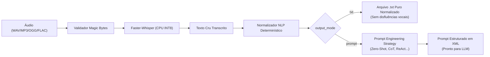

# 🏛️ Decisões Arquiteturais — Audio Prompt Engine (ADR Digest)

> **Documento público consolidado de Decisões de Arquitetura de Software (ADR-001 e ADR-002).**  
> Este registro formal documenta as escolhas tecnológicas, motivações, alternativas descartadas, diagramas de fluxo e garantias de segurança que norteiam o projeto.

---

## 📌 Sumário Executivo

O **`audio-prompt-engine`** é uma plataforma backend em Python 3.12 (FastAPI) projetada para eliminar o ruído da **fala humana espontânea** e transformá-la em duas saídas de alto valor:
1. **Texto Limpo (`.txt`):** Normalização linguística determinística sem disfluências vocais.
2. **Prompts Otimizados (`prompt`):** Estrutura cognitiva de alta fidelidade para consumo direto por LLMs modernos (Claude, GPT-4, Llama 3, DeepSeek) aplicando **6 técnicas consagradas de engenharia de prompt**.

Toda a inferência ocorre **100% localmente em CPU**, sem custos de APIs externas e com soberania total sobre os dados.

---

## 🧭 Índice
1. [ADR-001: Transcrição Local, Pipeline Dual e Engenharia de Prompt](#-adr-001-transcrição-local-pipeline-dual-e-engenharia-de-prompt)
   - [Contexto e Problema](#11-contexto-e-problema)
   - [Decisão: Faster-Whisper (CTranslate2 INT8)](#12-decisão-faster-whisper-ctranslate2-int8)
   - [O Decodificador ASR como SLM Contextual](#13-o-decodificador-asr-como-slm-contextual)
   - [Pipeline Dual e Strategy Pattern](#14-pipeline-dual-e-strategy-pattern)
   - [As 6 Técnicas de Engenharia de Prompt](#15-as-6-técnicas-de-engenharia-de-prompt)
   - [Pentágono de Defesa Backend](#16-pentágono-de-defesa-backend)
2. [ADR-002: Containerização Hermética com Docker, UV e Segurança Não-Root](#-adr-002-containerização-hermética-com-docker-uv-e-segurança-não-root)
   - [Contexto e Hermeticidade C++](#21-contexto-e-hermeticidade-c)
   - [Decisão: UV Multi-stage e Usuário Não-Root](#22-decisão-uv-multi-stage-e-usuário-não-root)
   - [Volumes Persistentes e Cache](#23-volumes-persistentes-e-cache)
   - [Ciclo de Vida e Healthcheck](#24-ciclo-de-vida-e-healthcheck)
3. [ADR-003: Motor de Inferência LLM Desacoplado (Ollama e Grok)](#-adr-003-motor-de-inferência-llm-desacoplado-ollama-e-grok)
   - [Contexto e Desacoplamento Transacional](#31-contexto-e-desacoplamento-transacional)
   - [Decisão: Provider Strategy Agnóstico](#32-decisão-provider-strategy-agnóstico-ollama-local-vs-grok-cloud)
   - [Zero Dependências Adicionais](#33-zero-dependências-adicionais-urllibrequest)
   - [Impacto no Pentágono de Defesa](#34-impacto-no-pentágono-de-defesa)
4. [Matriz Comparativa de Alternativas Descartadas](#-matriz-comparativa-de-alternativas-descartadas)
5. [Tabela de Rotas e Contratos da API](#-tabela-de-rotas-e-contratos-da-api)

---

## 🎙️ ADR-001: Transcrição Local, Pipeline Dual e Engenharia de Prompt

- **Status:** Aprovada e Implementada
- **Data:** 2026-10-19
- **Escopo:** Reconhecimento acústico, normalização NLP, síntese de prompts e segurança da API.

### 1.1 Contexto e Problema
A fala humana em reuniões técnicas, áudios de tarefas ou ditados espontâneos é repleta de hesitações vocais (*"ééé"*, *"tipo assim"*, *"né"*), descontinuidades gramaticais e repetições. Submeter esse texto cru diretamente a modelos de linguagem (LLMs) resulta em alucinações, instruções frouxas e respostas prolixas. 

Por outro lado, utilizar APIs de terceiros na nuvem para transcrever voz corporativa acarreta:
- Custos recorrentes e tarifação por minuto.
- Riscos de privacidade e conformidade (LGPD, GDPR, segredos industriais).
- Dependência de conexão externa de rede e limites de taxa (*rate limiting*).

### 1.2 Decisão: Faster-Whisper (CTranslate2 INT8)
Adotou-se o motor **`faster-whisper`**, uma reimplementação do Whisper da OpenAI utilizando o runtime **CTranslate2** em C++ com quantização **INT8** para CPUs convencionais (AVX2 / AVX-512):
- **Consumo de Memória:** O modelo `base` consome aproximadamente **150 MB de RAM** (contra >800 MB do PyTorch puro).
- **Velocidade:** Inferência até **4x mais rápida** que a biblioteca original, viabilizando processamento em frações de segundo em CPUs comuns sem necessidade de placas de vídeo dedicadas (GPUs NVIDIA).
- **Ciclo Singleton:** O modelo é instanciado uma única vez em memória no ciclo de vida da aplicação (`FastAPI lifespan`), prevenindo vazamentos de memória e sobrecarga de CPU por requisição.

```
                      FLUXO TRANSFORMER ENCODER-DECODER
                      
  Áudio (WAV/MP3) ──► [ Espectrograma Log-Mel ] ──► [ AUDIO ENCODER ]
                                                           │ (Representações
                                                           │  Acústicas / Fonemas)
                                                           ▼
  Tokens Anteriores ────────► [ TEXT DECODER (SLM Contextual) ] ──► Próximo Token
                                (Prevê tokens gramaticais, pontuação,
                                 capitalização e coerência léxica)
```

### 1.3 O Decodificador ASR como SLM Contextual
Existe uma distinção crucial entre sistemas legados de fala e o Whisper:
1. **Audio Encoder:** Decompõe blocos de 30 segundos de áudio em espectrogramas Log-Mel de 80 canais e gera representações vetoriais densas dos fonemas.
2. **Text Decoder:** Atua como um **Small Language Model (SLM) autoregressivo**. Ele não faz mapeamento mecânico som-letra; ele calcula a probabilidade estatística do próximo token condicionado aos tokens anteriores e ao vetor acústico.
   - **Desambiguação Homófona:** Distingue *"sessão de cinema"* de *"seção de compras"* e *"cessão de direitos"* unicamente pelo contexto linguístico da sentença.
   - **Pontuação e Capitalização:** Insere pausas, vírgulas, pontos e letras maiúsculas de forma nativa.

### 1.4 Pipeline Dual e Strategy Pattern
O endpoint `/api/v1/transcriptions` implementa o padrão de projeto **Strategy** baseado no parâmetro `output_mode`:



- **Modo `.txt`:** Aplica expressões regulares e filtros determinísticos para remover vícios de linguagem em português (*"ééé"*, *"ããã"*, *"tipo assim"*, *"né"*, *"olha só"*), normalizar espaços e capitalizar frases.
- **Modo `prompt`:** Recebe o texto limpo e o encapsula na técnica solicitada, isolando a fala humana sob a tag `<user_speech>` para impedir que instruções faladas sobrescrevam as regras do sistema.

### 1.5 As 6 Técnicas de Engenharia de Prompt
O motor suporta 6 estratégias consolidadas no mercado de IA:

| Técnica | Objetivo Principal | Exemplo de Aplicação |
|---|---|---|
| **`zero_shot`** | Instrução direta, concisa e imperativa sem exemplos. | Consultas rápidas, comandos diretos, formatações simples. |
| **`few_shot`** | Injeção de pares estruturados de `Exemplo -> Saída`. | Classificação rigorosa de dados, extração JSON/YAML. |
| **`chain_of_thought` (CoT)** | Exigência de raciocínio passo a passo antes da resposta final. | Depuração de bugs complexos, matemática, lógica de negócios. |
| **`role_prompting`** | Atribuição de persona especialista com tom e restrições. | Code review sênior, auditoria de segurança, consultoria. |
| **`co_star`** | Framework corporativo: Context, Objective, Style, Tone, Audience, Response. | Especificações formais, relatórios executivos, propostas. |
| **`react`** | Loop autônomo estruturado: Thought ➔ Action ➔ Observation ➔ Final Answer. | Agentes autônomos com chamada de ferramentas (*tool calling*). |

### 1.6 Pentágono de Defesa Backend
A segurança da API é alicerçada em 5 pilares inegociáveis:
1. **Banco sem Tranca:** Isolamento Multi-Tenant estrito (`WHERE id = ? AND tenant_id = ?`). Todas as conexões físicas SQLite são liberadas em blocos `finally: conn.close()`.
2. **Permissão no Servidor (RBAC):** Chaves com papel `viewer` só têm acesso a leitura (`GET`). Requisições de ingestão (`POST`) exigem papel `operator` ou `admin`, respondendo com `403 Forbidden` imediato em caso de violação.
3. **Prevenção de IDOR e Validação de UUID:** Rotas que recebem `job_id` validam a sintaxe de UUID v4 antes de qualquer query ao banco; valores fora do padrão ou pertencentes a outros inquilinos respondem uniformemente com `404 Not Found`.
4. **Chaves e Defaults Seguros:** Segredos gerenciados via `.env`. Arquivos de áudio temporários são nomeados com UUID e removidos fisicamente do disco em `finally: os.unlink()`.
5. **Sanitização de Inputs & Magic Bytes:**
   - **Upload em Chunks (64 KB):** Gravação em stream com interrupção instantânea com `413 Content Too Large` caso o arquivo ultrapasse 25 MB, protegendo contra DoS por estouro de memória (OOM).
   - **Magic Bytes Reais:** Validação de cabeçalhos binários (`RIFF/WAVE`, `ID3/MP3`, `OggS`, `fLaC`, `ftyp`). Executáveis (.exe/ELF) ou scripts renomeados são barrados com `400 Bad Request`.
   - **Mitigação de Acoustic Prompt Injection:** A fala transcrita é sanitizada via escape de entidades XML (`&lt;`, `&gt;`), impedindo que comandos falados fechem a tag `</user_speech>`.
   - **Aderência Contratual Estrita:** Se `output_mode="prompt"`, a ausência de `prompt_technique` é rejeitada com `422 Unprocessable Content` (sem fallbacks silenciosos arbitrários).

---

## 🐳 ADR-002: Containerização Hermética com Docker, UV e Segurança Não-Root

- **Status:** Aprovada e Implementada
- **Data:** 2026-10-29
- **Escopo:** Empacotamento Docker, orquestração Docker Compose, persistência de dados e segurança do runtime.

### 2.1 Contexto e Hermeticidade C++
Bibliotecas de processamento de áudio dependem fortemente de binários do sistema operacional (`ffmpeg`, utilitários de decodificação e bibliotecas de compiladores C++). Rodar o serviço diretamente em máquinas host sem isolamento causava atritos comuns:
- Ausência de `ffmpeg` no PATH do host.
- Variações nas instruções vetoriais compiladas entre distribuições Linux e Windows.
- Lentidão do `pip` padrão na instalação de dependências de machine learning.

### 2.2 Decisão: UV Multi-stage e Usuário Não-Root
Adotou-se a imagem base oficial **`ghcr.io/astral-sh/uv:python3.12-bookworm-slim`**:
- **Compilação e Instalação com `uv`:** O instalador `uv` em Rust compila e instala os pacotes do projeto em poucos segundos (`uv pip install --system --no-cache .`).
- **Usuário Não-Root Dedicado (`appuser:10001`):** Em conformidade com o *CIS Docker Benchmark*, o container cria e executa todo o processo Uvicorn sob o usuário `appuser` (UID 10001 / GID 10001). Privilégios de superusuário (`root`) são terminantemente desabilitados no runtime.
- **Isolamento de Contexto (`.dockerignore`):** Arquivos confidenciais (`.env`), histórico local (`.git/`), suítes de teste (`tests/`) e caches são excluídos do contexto de build.

```dockerfile
# Trecho representativo do Dockerfile
FROM ghcr.io/astral-sh/uv:python3.12-bookworm-slim AS runtime

RUN apt-get update && apt-get install -y --no-install-recommends \
    ffmpeg ca-certificates && rm -rf /var/lib/apt/lists/*

RUN groupadd -g 10001 appuser && \
    useradd -u 10001 -g appuser -m -s /bin/bash appuser

WORKDIR /app
RUN mkdir -p /app/data /home/appuser/.cache/huggingface && \
    chown -R appuser:appuser /app /home/appuser

COPY --chown=appuser:appuser pyproject.toml README.md ./
COPY --chown=appuser:appuser src ./src

RUN uv pip install --system --no-cache .
USER appuser
CMD ["uvicorn", "src.main:app", "--host", "0.0.0.0", "--port", "8000"]
```

### 2.3 Volumes Persistentes e Cache
O `docker-compose.yml` mapeia duas zonas críticas de armazenamento:
1. **Bind Mount do Banco de Dados (`./data:/app/data`):** Garante que o arquivo SQLite [`audio_prompt_engine.db`](file:///C:/Users/elyss/Desktop/Projects/audio-prompt-engine/data/audio_prompt_engine.db) resida no disco físico do host. A aplicação cria a subpasta e as tabelas automaticamente se não existirem.
2. **Named Volume para Pesos do Whisper (`hf_cache`):** Montado em `/home/appuser/.cache/huggingface` (`HF_HOME`). O download de ~145 MB do modelo acontece exclusivamente na primeira subida do container. Reinicializações subsequentes (`docker compose restart`) reutilizam o cache local instantaneamente.

### 2.4 Ciclo de Vida e Healthcheck
O container possui monitoramento ativo de integridade usando a biblioteca nativa do Python (`urllib.request`), eliminando a necessidade de instalar pacotes pesados como `curl`:
```yaml
healthcheck:
  test: python3 -c "import urllib.request; urllib.request.urlopen('http://127.0.0.1:8000/health').read()"
  interval: 30s
  timeout: 5s
  retries: 3
  start_period: 10s
```

---

## 🤖 ADR-003: Motor de Inferência LLM Desacoplado (Ollama e Grok)

- **Status:** Aprovada e Implementada
- **Data:** 2026-10-30
- **Escopo:** Execução desacoplada de prompts sintetizados em provedores de LLM locais e em nuvem, persistência transacional no SQLite e zero dependências externas.

### 3.1 Contexto e Desacoplamento Transacional
Após a compilação do áudio em prompt estruturado (ADR-001), o usuário pode desejar submeter essa instrução a um modelo de linguagem para obter código, análise ou respostas finais. 

Disparar a inferência diretamente acoplada ao endpoint de transcrição de áudio traria graves desvantagens:
1. **Latência Excessiva:** Somar o tempo de transcrição acústica (segundos) ao tempo de geração do LLM (segundos/minutos) resultaria em timeouts HTTP na conexão cliente.
2. **Perda de Auditoria:** Caso o LLM falhasse, o prompt compilado da fala humana se perderia sem rastro.
3. **Custo Duplicado de CPU:** Qualquer retry exigiria reenviar o arquivo de áudio e reprocessar o Whisper do zero.

**Decisão de Desacoplamento:** O prompt compilado é persistido e indexado no SQLite com seu respectivo `job_id` (UUID v4) e isolamento por `tenant_id` **antes** de qualquer chamada a provedores de LLM. A execução é acionada via rota dedicada `POST /api/v1/transcriptions/{job_id}/execute`.

### 3.2 Decisão: Provider Strategy Agnóstico (Ollama Local vs. Grok Cloud)
Adotou-se o padrão de projeto **Strategy** através da interface abstrata `ILLMProvider`:
- **`OllamaProvider` (Local / Offline / Privacidade Total):**
  - Conecta-se a instâncias locais do **Ollama** (ex: `llama3`, `deepseek-coder-v2`, `mistral`, `phi3`).
  - Custo marginal zero, operação 100% offline e garantia estrita de privacidade e conformidade (LGPD/GDPR), sem que nenhum token saia da rede local.
- **`GrokProvider` (Cloud / Alta Capacidade):**
  - Integração com a API em nuvem **xAI Grok** (ex: `grok-beta`) para tarefas analíticas que demandem modelos de grande porte (70B+) com raciocínio contextual avançado.

### 3.3 Zero Dependências Adicionais (`urllib.request`)
Em vez de instalar SDKs pesados e proprietários (`openai`, `anthropic`, `httpx` adicionais), toda a comunicação HTTP com os provedores é realizada utilizando a biblioteca padrão do Python (`urllib.request` e `json` nativos). Isso preserva o container enxuto, rápido para compilar via `uv` e imune a vulnerabilidades de supply chain em bibliotecas de terceiros.

### 3.4 Impacto no Pentágono de Defesa
1. **Permissão no Servidor (RBAC):** Apenas chaves com papel `operator` ou `admin` podem disparar inferências de LLM. Chaves `viewer` são bloqueadas com `403 Forbidden`.
2. **Anti-IDOR:** A rota `/execute` valida sintaticamente o UUID v4 do `job_id` e busca o registro filtrando obrigatoriamente por `WHERE id = ? AND tenant_id = ?`. Tentativas de acesso entre inquilinos respondem com `404 Not Found`.
3. **Integridade de Chaves:** Se o provedor Grok for solicitado sem que `XAI_API_KEY` esteja configurada, o endpoint rejeita a requisição imediatamente com `422 Unprocessable Content`.
4. **Resiliência a Falhas:** Quedas ou timeouts do provedor upstream retornam `502 Bad Gateway` controlado, sem expor stack traces ou dados sensíveis do servidor.

---

## ⚖️ Matriz Comparativa de Alternativas Descartadas

| Alternativa Analisada | Veredito | Justificativa do Descarte |
|---|---|---|
| **`openai-whisper` (PyTorch puro)** | **Descartada** | Consumo excessivo de RAM (>800 MB), inferência 4x mais lenta em CPU e dependência pesada de CUDA/PyTorch. |
| **Whishper Full Stack (Docker + Mongo + LibreTranslate)** | **Descartada** | Excesso de sobrecarga (>4 GB de imagens e >3 GB de RAM) para um projeto focado no motor de transcrição e engenharia de prompts. |
| **Executar LLM síncrono acoplado ao upload de áudio** | **Descartada** | Causaria timeouts HTTP no upload e impediria auditoria, histórico e retentativas do prompt. |
| **SDKs proprietários pesados para LLMs (openai/anthropic pip)** | **Descartada** | Incharia a imagem Docker desnecessariamente. A standard library `urllib.request` atende perfeitamente ao protocolo REST dos provedores. |
| **Imagem Docker rodando como `root` (UID 0)** | **Descartada** | Violação severa de segurança; risco de *Container Escape* em caso de falha nas dependências nativas C/C++. |
| **Build padrão com `pip install` tradicional** | **Descartada** | Tempo de compilação 5 a 10 vezes maior comparado à velocidade determinística do instalador `uv`. |

---

## 📋 Tabela de Rotas e Contratos da API

Todas as rotas de negócio exigem autenticação via cabeçalho HTTP `X-API-Key`.

| Método | Endpoint | Permissão Mínima | Resposta Sucesso | Descrição |
|---|---|---|---|---|
| `POST` | `/api/v1/transcriptions` | `operator` ou `admin` | `201 Created` | Ingestão de áudio (`multipart/form-data`) gerando texto limpo ou prompt formatado. |
| `GET` | `/api/v1/transcriptions` | `viewer` | `200 OK` | Listagem paginada do histórico pertencente exclusivamente ao tenant autenticado. |
| `GET` | `/api/v1/transcriptions/{id}` | Dono do job | `200 OK` | Detalhes completos do job (metadados, texto bruto, texto limpo e prompt sintetizado). |
| `GET` | `/api/v1/transcriptions/{id}/txt` | Dono do job | `200 OK` | Download direto da transcrição normalizada em `text/plain; charset=utf-8`. |
| `POST` | `/api/v1/transcriptions/{id}/execute` | `operator` ou `admin` | `200 OK` | Executa o prompt sintetizado contra LLM (Ollama Local ou Grok Cloud). |
| `GET` | `/api/v1/techniques` | Aberto / Autenticado | `200 OK` | Catálogo explicativo das 6 técnicas de engenharia de prompt com orientações de uso. |
| `GET` | `/health` (e `/api/v1/health`) | Aberto | `200 OK` | Verificação de integridade operacional e identificação do modelo Faster-Whisper. |

---

## 🔬 Homologação e Garantia de Qualidade

- **Suíte de Testes:** **69 testes automatizados aprovados (100% de sucesso)** cobrindo testes unitários, fluxos E2E, serviços de inferência LLM (Ollama e Grok) e testes de segurança do Pentágono de Defesa.
- **Chaos Testing:** **23/23 testes de caos ao vivo aprovados** contra o container Docker ativo, com validação de resiliência a rajadas concorrentes, saturação de payload (>25 MB), corrupção proposital de bytes e injeção de prompt acústico.

